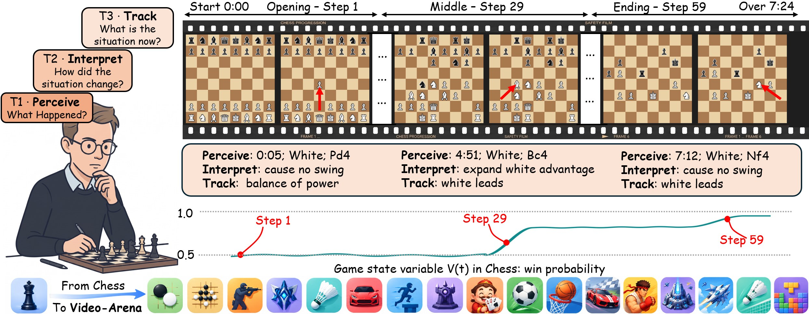
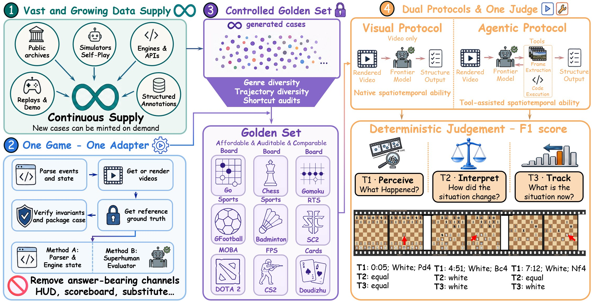

<div align="center">

<p align="center">
  
</p>

<h1 align="center" style="font-size:3.2em;line-height:1.1;margin:0.2em 0 0.15em;">Video-Arena</h1>

<h2 align="center" style="font-size:1.5em;line-height:1.3;font-weight:600;margin:0 0 0.9em;border:none;">A Scalable Agentic Video Benchmark for Spatiotemporal Capability</h2>

<p align="center" style="font-size:1.08em;line-height:1.8;">
<b>Kuan Zhang</b><sup>1,2,*,‡</sup> &nbsp; <b>Yukun Chen</b><sup>1,3,*,‡</sup> &nbsp; <b>Zhihao Yang</b><sup>1,3,*,‡</sup> &nbsp; Yue Su<sup>4</sup> &nbsp; Xiangnan Wu<sup>3</sup><br>
Zirong Chen<sup>2</sup> &nbsp; Run Luo<sup>1,5,‡</sup> &nbsp; Tao Tan<sup>1</sup> &nbsp; <b>Yinhe Zheng</b><sup>1,†</sup> &nbsp; <b>Yiming Li</b><sup>2,†</sup>
</p>

<p align="center" style="line-height:1.75;">
<sup>1</sup>miHoYo Honkai AI R&amp;D Team &nbsp;&nbsp;·&nbsp;&nbsp; <sup>2</sup>College AI, Tsinghua University<br>
<sup>3</sup>University of Chinese Academy of Sciences &nbsp;&nbsp;·&nbsp;&nbsp; <sup>4</sup>MMLab, The University of Hong Kong &nbsp;&nbsp;·&nbsp;&nbsp; <sup>5</sup>National University of Singapore
</p>

<p align="center" style="font-size:0.9em;">
<sup>*</sup>Equal contribution &nbsp;&nbsp; <sup>†</sup>Corresponding author &nbsp;&nbsp; <sup>‡</sup>Work done while interning at miHoYo
</p>

<p align="center">
  <a href="https://videoarena-bench.github.io" style="display:inline-block;margin:2px;"></a>
  <a href="https://videoarena-bench.github.io" style="display:inline-block;margin:2px;"></a>
  <a href="https://github.com/THUSI-Lab/VideoArena" style="display:inline-block;margin:2px;"></a>
  <a href="https://huggingface.co/datasets/THUSI-Lab/Video-Arena" style="display:inline-block;margin:2px;"></a>
  <a href="https://www.apache.org/licenses/LICENSE-2.0" style="display:inline-block;margin:2px;"></a>
</p>

</div>

<p align="center">
  
</p>

<p align="center"><i>Watch one long, HUD-free match and report, for every critical event, what happened (T1), how it changed the hidden game state (T2), and where that leaves the match (T3).</i></p>

## Overview

Video-Arena asks a model to watch a full recording of a real game and reconstruct a **hidden game
state variable** $V_t$ (a win probability, a net-worth lead, a score) that is never drawn on screen.
Scoreboards, clocks, evaluation bars, kill feeds and names are removed when the video is rendered,
so the only way to report $V_t$ is to have followed the whole match.

- **180 cases, 9 games, 6 genres**: Go, Chess and Gomoku (board), Doudizhu (card), CS2 (FPS),
  DOTA 2 (MOBA), StarCraft II (RTS), and Google Research Football and Badminton (sports). There are 20 cases per
  game, about 74 hours of video and 15,278 reference tuples.
- **Ground truth from the game, not from annotators.** Replay and demo parsers, engine traces,
  and pinned evaluators (KataGo, Stockfish, Rapfi, a hidden-hand PIMC estimator).
- **One deterministic judge per game.** Strict tuple F1 (all three tiers right, time within
  ±3 s); no LLM judge anywhere.
- **Two protocols, two runtimes.** Protocol A (single-request video understanding) and Protocol B
  (an agent in a sandbox with the video, ffmpeg and Python), each runnable natively or on
  [Harbor](https://github.com/harbor-framework/harbor).

This GitHub repository holds the evaluation code, the documentation, and each game's task
definition and judge. The videos and the ground truth are on Hugging Face,
[THUSI-Lab/Video-Arena](https://huggingface.co/datasets/THUSI-Lab/Video-Arena), and are fetched with
`hf download` into the same tree (Getting Started, step 1). The case-building pipelines are not released; `docs/GROUND_TRUTH.md` documents
how every label was produced and which engine and budget it was pinned to.

<p align="center">
  
</p>

## Repository Layout

Everything except `media/` and `gt/` is in this repository. The two folders marked `[HF]` are on
Hugging Face only and land in place when downloaded with `--local-dir .`.

```text
VideoArena/
|-- README.md                       this file
|-- LICENSE                         Apache-2.0
|-- assets/                         images for this README (teaser, pipeline, logos)
|-- docs/
|   |-- PROTOCOLS.md                the two protocols in full, and what a comparable run requires
|   |-- HARBOR.md                   running both protocols on Harbor: image, datasets, network modes
|   `-- GROUND_TRUTH.md             per-game source, GT mechanism, V definition, engine versions
|-- tools/
|   |-- va_core.py                  the corpus contract: resolve, instruction_for, extract_answer, run_judge
|   |-- score.py                    score an answers/ directory; --oracle / --empty self-checks
|   |-- run_protocol_a.py           native Protocol A runner (frame grid + one chat call)
|   |-- run_protocol_b.py           native Protocol B runner (sandbox + your agent command)
|   |-- make_harbor.py              build the Harbor dataset (Protocol B, or --protocol A)
|   `-- harbor/
|       |-- Dockerfile              the offline sandbox image (ffmpeg + Python video stack)
|       |-- protocol_a_agent.py     the Harbor agent for Protocol A
|       `-- validate_harbor.py      offline check of a generated Harbor dataset
`-- tasks/
    |-- go/  chess/  gomoku/  doudizhu/  cs2/  dota2/  sc2/  gfootball/  badminton/
    `-- <game>/
        |-- instruction.md          the task: event vocabulary, V definition, answer schema
        |-- answer_seed.json        the empty answer {"events": []}
        |-- judge.py                the deterministic scorer (standard library only)
        |-- cases.json              the frozen 20 case ids, in order
        |-- CASE_TYPES.json         per-case stratification label
        |-- media/<case_id>.mp4     [HF] the video, the only model input
        `-- gt/<case_id>_gt.json    [HF] reference tuples, for the offline scorer only
```

`tasks/badminton/` additionally holds `ATTRIBUTION.md` (the ShuttleSet notice).

Sizes of the Hugging Face download (videos + ground truth):

| Game | Genre | Cases | Video | Avg. length (min) | Size |
|---|---|---:|---|---:|---:|
| Go | board | 20 | 612² · 25 fps | 31.8 | 5.4 MB |
| Chess | board | 20 | 548² · 1 fps | 31.0 | 2.3 MB |
| Gomoku | board | 20 | 504² · 25 fps | 3.2 | 1.0 MB |
| Doudizhu | card | 20 | 1280×720 · 24 fps | 4.4 | 48 MB |
| CS2 | FPS | 20 | 768² · 15 fps | 38.9 | 369 MB |
| DOTA 2 | MOBA | 20 | 768² · 15 fps | 47.8 | 813 MB |
| StarCraft II | RTS | 20 | 1536² · 5.6 fps | 19.4 | 2.5 GB |
| GFootball | sports | 20 | 1280×720 · 24 fps | 25.0 | 7.2 GB |
| Badminton | sports | 20 | 1280×720 · 15 fps | 19.9 | 271 MB |
| **Total** | | **180** | | | **≈ 11.8 GB** |

## Getting Started

**1. Clone the code and download the data.** The videos and ground truth come from Hugging Face,
either all of them or only the games you need:

```bash
git clone https://github.com/THUSI-Lab/VideoArena.git
cd VideoArena
pip install -U huggingface_hub

# all 9 games (about 11.8 GB)
hf download THUSI-Lab/Video-Arena --repo-type dataset --local-dir . \
    --include "tasks/*/media/*" "tasks/*/gt/*"

# e.g. the three board games only (a few MB)
hf download THUSI-Lab/Video-Arena --repo-type dataset --local-dir . \
    --include "tasks/go/*" "tasks/chess/*" "tasks/gomoku/*"
```

The Hugging Face repository also carries a copy of the code and docs, so
`hf download THUSI-Lab/Video-Arena --repo-type dataset --local-dir Video-Arena` alone gives a
complete release as well.

**2. Self-check the corpus and the scorer.** Python 3.8+, standard library only, no network:

```bash
python tools/va_core.py          # corpus check: 9 games x 20 cases, every file present
python tools/score.py --oracle   # ground truth fed back: all 180 cells must read 1.0
python tools/score.py --empty    # the empty seed:        all 180 cells must read 0.0
```

**3. Prepare the environment for the runs you need.** Scoring needs nothing beyond Python, but running the protocols does:

| To run | Needs |
|---|---|
| Protocol A, native | `ffmpeg` + `ffprobe` on PATH, and an OpenAI-compatible endpoint |
| Protocol B, native | the agent's whole toolset **on this machine** (see below); nothing is installed for the agent |
| Harbor, A or B | Docker and `harbor` (Python 3.11+); the image built from `tools/harbor/Dockerfile` carries the toolset |

In Protocol B the agent is told that ffmpeg, Python and the video tools are *already installed*, and is
forbidden to install anything. The runners never install packages. For a native Protocol B run, set
up the same toolset as the Harbor image, so that native and Harbor numbers are comparable:

```bash
# Debian/Ubuntu; on macOS: brew install ffmpeg tesseract
sudo apt-get install -y ffmpeg tesseract-ocr tesseract-ocr-eng
pip install numpy scipy pandas pillow opencv-python-headless scikit-image             imageio imageio-ffmpeg av matplotlib pytesseract tqdm
```

`run_protocol_b.py` checks this before the first cell. A missing `ffmpeg`, `ffprobe` or `python3` is a hard error; missing
Python modules or tesseract only print a warning.

## Running the Evaluation

The same 180 cases are asked two ways, with identical task text: one `instruction.md` per game is
rendered per protocol by `va_core.instruction_for()`. Every runner writes
`<out>/answers/<game>/<case_id>.json`, which `tools/score.py` scores.

| | Protocol A · video understanding | Protocol B · agentic |
|---|---|---|
| Model input | 1 FPS frame grid, at most 256 frames, longest side 768 px, explicit timestamps | the full `match.mp4` in a sandbox, plus `instruction.md` and a seeded `answer.json` |
| Interaction | one request, one reply holding one JSON object; no tools | a coding agent over many turns; samples frames and writes its own tools |
| Budget | one call | 200 turns and 120 min per cell |
| Native | `tools/run_protocol_a.py` | `tools/run_protocol_b.py --agent-cmd ...` |
| Harbor | `make_harbor.py --protocol A` + `protocol_a_agent` | `make_harbor.py` + any Harbor agent |

### Native Protocol A

Any OpenAI-compatible `/chat/completions` endpoint that accepts images:

```bash
export VA_API_KEY=...
python tools/run_protocol_a.py --model <model> --base-url https://<endpoint>/v1 \
    --game all --out runs/<model>-A --workers 5
python tools/score.py --answers runs/<model>-A/answers
```

Useful flags: `--game <name>` (repeatable), `--limit N` (first N cases per game),
`--reasoning-effort`, `--extra-body '{"chat_template_kwargs": {"enable_thinking": true}}'` (e.g. a
Qwen model on vLLM), and `--jpeg-q` for gateways with a request-body cap (the frame grid never
changes; `run.json` records the quality used).

### Native Protocol B

The runner builds a fresh sandbox per cell (outside the repo, holding only the three files) and
runs your agent CLI inside it. The placeholders are `@PROMPT_FILE@`, `@PROMPT@` and `@SANDBOX@`.

```bash
python tools/run_protocol_b.py --game all --out runs/<agent>-B --workers 3 \
    --agent-cmd "claude -p @PROMPT_FILE@ --max-turns 200"
python tools/score.py --answers runs/<agent>-B/answers
```

The agent runs on this machine with the toolset from step 3; if `--agent-cmd` starts the agent in a
container of its own, add `--skip-preflight`. The runner enforces the wall clock (`--timeout-min 120`). Pass the same turn cap
(`--max-turns 200`) to your agent's own flag. The native runner does not enforce isolation: the prompt forbids
network use, so audit the agent transcript afterwards, or use Harbor.

### Harbor (Protocol A and B)

On Harbor the sandbox is offline at the network level, and the ground truth lives only in a separate
verifier container. The toolset is baked into the image (`python:3.11-slim` + ffmpeg, tesseract, tmux
and the Python video stack), because it cannot be fetched once a trial is offline. The generated datasets hold task folders only; the videos are mounted from the
downloaded `tasks/*/media/`.

```bash
# the sandbox image
docker build -t video-arena/base:latest tools/harbor
export VA_MEDIA_ROOT="$PWD/tasks"       # each task mounts $VA_MEDIA_ROOT/<game>/media/<case_id>.mp4

# Protocol B
python tools/make_harbor.py --out harbor/video-arena
python tools/harbor/validate_harbor.py harbor/video-arena
harbor run -p harbor/video-arena -a oracle                     # must score 1.0 on all 180 trials
harbor run -p harbor/video-arena -a terminus-2 -m <provider/model> --ak max_turns=200 -n 3

# Protocol A
python tools/make_harbor.py --out harbor/video-arena-a --protocol A
PYTHONPATH=tools/harbor harbor run -p harbor/video-arena-a \
    -a protocol_a_agent:ProtocolA -m openai/<model> -n 5 --ak reasoning_effort=high
```

Agents that run inside the container (`claude-code`, `codex`, ...) need the model API reachable
during the agent phase only. Generate with `--net phase` and add `--allow-agent-host <api host>`.
On Docker hosts without Harbor egress control, use `--net docker`. The agent runs as the
unprivileged user `agent`. [`docs/HARBOR.md`](docs/HARBOR.md) has the full details, including the
Protocol A agent options.

## Answer Format and Scoring

Every game uses the same root key: an answer is `{"events": [ ... ]}`, one complete tuple per
row, in the schema given by that game's `instruction.md`. Each judge has one CLI:

```bash
python tasks/<game>/judge.py --answer ANSWER.json --gt tasks/<game>/gt/<case_id>_gt.json \
                             --out reward.json --tol 3.0
```

- **Headline: strict tuple F1.** A predicted row matches a reference row when every non-temporal
  field is equal and the time is within ±3 s. Matching is one-to-one and independent of row order.
- **Diagnostics:** T1 event-localization F1, T2 update accuracy and T3 state accuracy (macro-averaged).
- **Reporting:** the overall number is the mean of the nine game means. Quote `n_scored/n_cases`.
  A cell that never ran is `missing`; a cell that ran and left no answer scores 0.0 and stays
  in the mean. Protocol B trajectories are stochastic, so cite game means rather than single cells.

See [`docs/PROTOCOLS.md`](docs/PROTOCOLS.md) for the complete rules of a comparable run.

## Data Hygiene

The ground truth ships in the clear so that the scorer can be inspected. Keep `gt/` out of prompts
and out of Protocol B sandboxes; `va_core.resolve()` hands the GT path only to the offline scorer.
Every `instruction.md` and `_gt.json` carries a `CANARY` line. **Please do not train on this
benchmark.** Case ids are permanent: a case is never renamed, and a new render gets a new id.

## License

Video-Arena is a **purely scientific research** project. We carry out **no commercial activity** of
any kind with it: the benchmark is not sold, licensed for a fee, or used in any product or service.

- **Data (videos and ground truth): non-commercial research use only.** The renders are
  information-reduced derivatives of game replays and game data, with no player names, faces,
  avatars, ranks, audio or other personal data. Do not use them for commercial purposes and do not
  train on them.
- **Game copyright belongs to the publishers.** All game content, copyrights and trademarks remain
  the property of their publishers and owners, in particular Blizzard Entertainment (StarCraft II)
  and Valve Corporation (Dota 2, Counter-Strike 2). Badminton derives from
  [ShuttleSet](https://arxiv.org/abs/2306.04948) (MIT, © 2022 Wei-Yao Wang), and its notice in
  `tasks/badminton/ATTRIBUTION.md` must accompany any redistribution of those renders.
- **Code: Apache-2.0.** The evaluation code, judges and documentation are released under the
  Apache License 2.0. It covers our code only and grants no right to any game content.

`docs/GROUND_TRUTH.md` lists the sources, access dates and engine versions for every game. Please
read the upstream terms before use.

## Citation

```bibtex
@article{zhang2026videoarena,
  title   = {Video-Arena: A Scalable Agentic Video Benchmark for Spatiotemporal Capability},
  author  = {Zhang, Kuan and Chen, Yukun and Yang, Zhihao and Su, Yue and Wu, Xiangnan and
             Chen, Zirong and Luo, Run and Tan, Tao and Zheng, Yinhe and Li, Yiming},
  journal = {arXiv preprint},
  year    = {2026}
}
```
